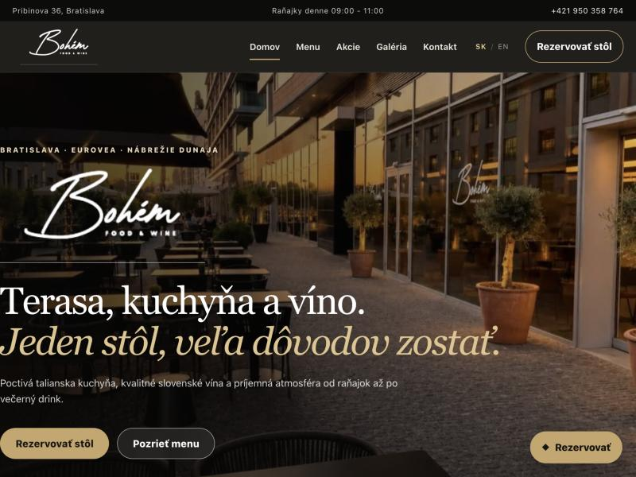

# Bohém Food & Wine — restaurant website

Bilingual (Slovak / English) website concept for **Bohém Food & Wine**, an Italian kitchen and wine bar with a terrace on the Danube embankment in Eurovea, Bratislava.

**Live demo:** https://h010grams.github.io/bohem-restaurant/

## Features

- **Two languages:** Slovak pages in the root folder, English pages in `/en`, with a SK / EN switch on every page
- **Pages:** home, menu, promotions, gallery, contact and table reservation
- **Full menu** with prices, portion sizes and allergens
- **Promotions:** Happy Hour (every day 18:00–20:00, Spritz 1+1 free), a free spread or snack with a bottle of wine, and a free coffee with breakfast (09:00–11:00)
- **Table reservation form** that sends requests by email through FormSubmit — no backend required
- **Gallery** with consistent image crops and a lightbox
- **Mobile-first:** a floating reservation button on desktop and a Call / Book bar on phones
- **SEO:** structured data (schema.org JSON-LD) for the restaurant
- **Reviews section** that links to Google and Instagram instead of invented testimonials
- Optimized WebP images

## Tech stack

HTML5, CSS3 and vanilla JavaScript — a fully static site, no build step and no framework. Hosted on GitHub Pages; reservations handled by [FormSubmit](https://formsubmit.co).

## Running locally

Open `index.html` in a browser, or open the folder in VS Code and use the Live Server extension.

## Notes before a production launch

- The reservation form sends to the restaurant's mailbox; FormSubmit asks the mailbox owner to confirm it once with an activation link.
- Confirm the terms and duration of the promotions.
- Replace the Google search link with the restaurant's exact Google Business Profile URL.
- Add real guest quotes only once verified reviews are available.
- Add the final domain to the structured data and canonical tags.

## Author

**Nikita Kolotusha** — design and development.
GitHub: [@h010grams](https://github.com/h010grams)
